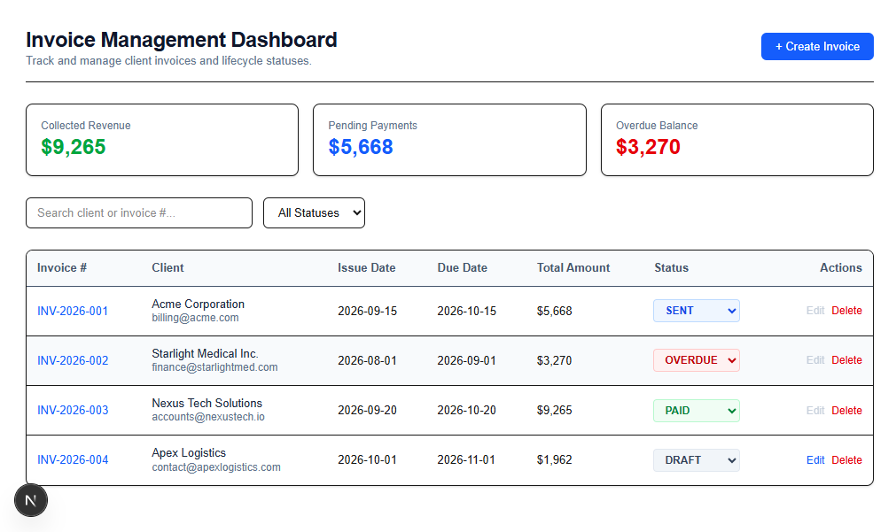
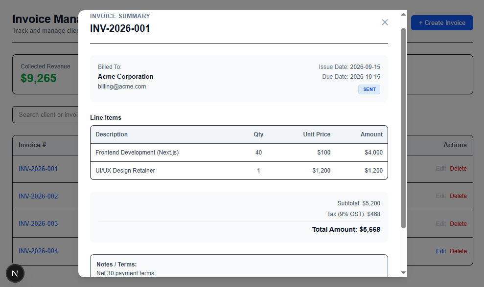
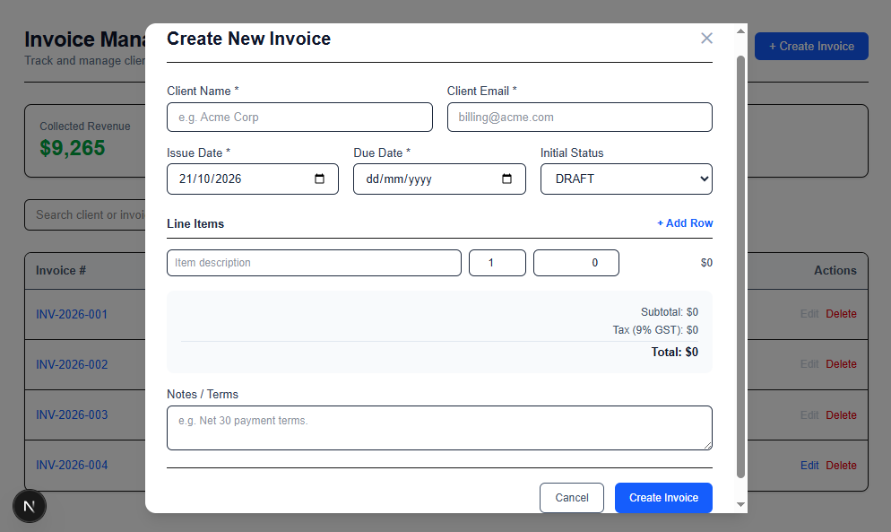

# Invoice Easily⚡

Invoice Easily is a modern, frontend-only SaaS dashboard for managing invoice lifecycles (`DRAFT`, `SENT`, `PAID`, `OVERDUE`, `VOID`). Built with **Next.js**, **TanStack Query**, and **Mock Service Worker (MSW)**, it simulates a full-stack CRUD application entirely in the browser without requiring a live backend database.

Application is deployed on **Netlify** and can be accessed at [https://invoice-easily.netlify.app](https://invoice-easily.netlify.app).







---

## ✨ Features

- **Invoice Lifecycle Management:** Create, inspect, update, and delete invoices with lifecycle status transitions.
- **Dynamic Line-Item Calculations:** Automatic line-item arithmetic with GST (9%) and subtotal/total calculations.
- **Client-Side Mock API:** Intercepts browser `fetch` requests via **MSW (Mock Service Worker)** for realistic network simulation and persistent state in memory.
- **Real-time Analytics:** Metrics summary cards tracking collected revenue, pending payments, and overdue balances.
- **Guarded Workflows:** Read-only protection for non-draft invoices and safety confirmation modals for deletions.

---

## 🛠️ Tech Stack

- **Framework:** Next.js (App Router)
- **State & Data Fetching:** TanStack Query (React Query)
- **Styling:** Tailwind CSS
- **API Mocking:** Mock Service Worker (MSW)
- **Language:** TypeScript
- **Deployment:** Netlify

---

## 🚀 Getting Started

1. **Clone the repository:**
   ```bash
   git clone [https://github.com/your-username/invoice-easily.git](https://github.com/your-username/invoice-easily.git)
   cd invoice-easily
   ```
2. **Install dependencies:**
   ```bash
   npm install
   ```
3. **Run the development server:**
   ```bash
   npm run dev
   ```
4. **Open your browser and navigate to:**
   ```
   http://localhost:3000
   ```
